# Gyro Mouse — System & Firmware Specification

**Project:** ESP32 + MPU6050 Bluetooth Gyro Mouse
**Document Type:** System Specification & Firmware Design
**Document Version:** 1.1
**Status:** Draft — Design Phase
**Development Platform:** PlatformIO
**Firmware Framework:** Arduino Framework (ESP32)
**Target Hardware:** LOLIN32 Lite (ESP32-WROOM-32)

---

# 1. Project Overview

## 1.1 Deskripsi Sistem

Gyro Mouse merupakan perangkat pointing device nirkabel yang menggunakan sensor gyroscope MPU6050 untuk mendeteksi gerakan rotasi tangan dan menerjemahkannya menjadi pergerakan kursor pada perangkat yang terhubung.

Sistem menggunakan ESP32 LOLIN32 Lite sebagai unit pemrosesan utama dan Bluetooth Low Energy (BLE) Human Interface Device (HID) sebagai protokol komunikasi dengan perangkat host.

Perangkat dirancang dalam bentuk handheld controller yang digenggam seperti remote control.

Pengendalian kursor dilakukan berdasarkan kecepatan sudut (angular velocity) yang dihasilkan gyroscope, bukan berdasarkan perpindahan posisi perangkat.

Sistem menggunakan dua tombol fisik sebagai input mouse:

- Button 1: Left Click.
- Button 2: Right Click.

Tombol dibaca oleh ESP32 menggunakan GPIO digital dengan internal pull-up. Firmware menerjemahkan perubahan kondisi tombol menjadi HID mouse button reports.

## 1.2 Tujuan Pengembangan

1. Mengembangkan perangkat air mouse berbasis ESP32 dan MPU6050.
2. Mengimplementasikan komunikasi Bluetooth HID Mouse.
3. Mengubah gerakan rotasi tangan menjadi pergerakan kursor.
4. Mengimplementasikan dua tombol fisik untuk left click dan right click.
5. Mengurangi pengaruh noise dan bias gyroscope terhadap pergerakan kursor.
6. Menghasilkan firmware modular yang mudah dikembangkan dan dikalibrasi.
7. Mendukung penggunaan pada PC dan perangkat mobile.

## 1.3 System Scope

### In Scope

- MPU6050 initialization dan sensor acquisition.
- Gyroscope calibration.
- Sensor axis mapping.
- Gyroscope bias compensation.
- Deadzone processing.
- Digital filtering.
- Cursor movement calculation.
- Cursor acceleration.
- Physical button input.
- Button debouncing.
- Left click event generation.
- Right click event generation.
- BLE HID Mouse communication.
- Bluetooth connection management.
- Runtime configuration.
- Serial debugging.

### Out of Scope (Initial Release)

- Optical tracking.
- Absolute position tracking.
- Magnetometer-based heading correction.
- Wi-Fi communication.
- Companion application.
- Gesture-based click.
- Advanced gesture customization.
- Multi-device simultaneous HID connection.

---

# 2. System Hardware Specification

## 2.1 Hardware Components

| Component       | Specification         | Function                      |
| --------------- | --------------------- | ----------------------------- |
| Main Controller | LOLIN32 Lite          | Main processing unit          |
| Microcontroller | ESP32-WROOM-32        | Data processing and Bluetooth |
| Motion Sensor   | MPU6050               | Gyroscope and accelerometer   |
| Button 1        | Momentary push button | Left click                    |
| Button 2        | Momentary push button | Right click                   |
| Communication   | I2C                   | ESP32 to MPU6050              |
| Wireless        | Bluetooth Low Energy  | HID communication             |
| Power           | USB / LiPo 1S         | Power supply                  |

## 2.2 Hardware Interface

### I2C Configuration

| Parameter     | Value   |
| ------------- | ------- |
| SDA           | GPIO21  |
| SCL           | GPIO22  |
| I2C Address   | 0x68    |
| I2C Frequency | 400 kHz |
| Sensor        | MPU6050 |
| Communication | I2C     |

### Button Configuration

| Parameter      | Left Button  | Right Button |
| -------------- | ------------ | ------------ |
| GPIO           | GPIO32       | GPIO33       |
| Input Mode     | INPUT_PULLUP | INPUT_PULLUP |
| Active State   | LOW          | LOW          |
| Inactive State | HIGH         | HIGH         |
| HID Function   | Left Click   | Right Click  |
| Debounce       | 25 ms        | 25 ms        |

### Sensor Configuration

| Parameter               | Initial Configuration                    |
| ----------------------- | ---------------------------------------- |
| Accelerometer Range     | ±8G                                     |
| Gyroscope Range         | ±500°/s                                |
| Digital Low Pass Filter | 21 Hz                                    |
| Sampling Frequency      | 200 Hz                                   |
| Sensor Output           | 3-axis acceleration and angular velocity |

Konfigurasi tersebut merupakan baseline dan dapat diubah melalui parameter firmware.

## 2.3 Physical Sensor Orientation

Orientasi pemasangan sensor menggunakan referensi koordinat perangkat.

| Sensor Axis | Physical Direction | Primary Function |
| ----------- | ------------------ | ---------------- |
| X           | Forward            | Roll             |
| Y           | Right              | Pitch            |
| Z           | Up                 | Yaw              |

Pemetaan awal fungsi gyro:

| Gyroscope Axis | System Function            |
| -------------- | -------------------------- |
| Gyro X         | Auxiliary / unused         |
| Gyro Y         | Vertical cursor movement   |
| Gyro Z         | Horizontal cursor movement |

Mapping harus dapat dikonfigurasi melalui firmware karena orientasi fisik sensor dapat berubah selama proses perakitan.

## 2.4 Wiring Specification

| LOLIN32 Lite | Component    | Connection    |
| ------------ | ------------ | ------------- |
| 3V3          | MPU6050 VCC  | Sensor power  |
| GND          | MPU6050 GND  | Common ground |
| GPIO21       | MPU6050 SDA  | I2C data      |
| GPIO22       | MPU6050 SCL  | I2C clock     |
| GPIO32       | Left Button  | Button signal |
| GPIO33       | Right Button | Button signal |
| GND          | Left Button  | Button ground |
| GND          | Right Button | Button ground |

### Button Wiring

Setiap tombol menggunakan konfigurasi active-low.

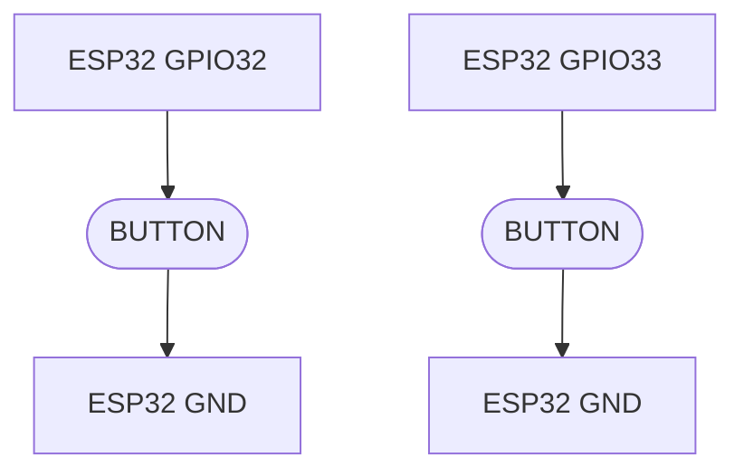

Tidak diperlukan resistor pull-up eksternal untuk konfigurasi awal karena firmware menggunakan internal pull-up ESP32.

Kedua tombol menggunakan koneksi independen dan tidak dihubungkan secara seri.

---

# 3. System Architecture

## 3.1 High-Level Architecture

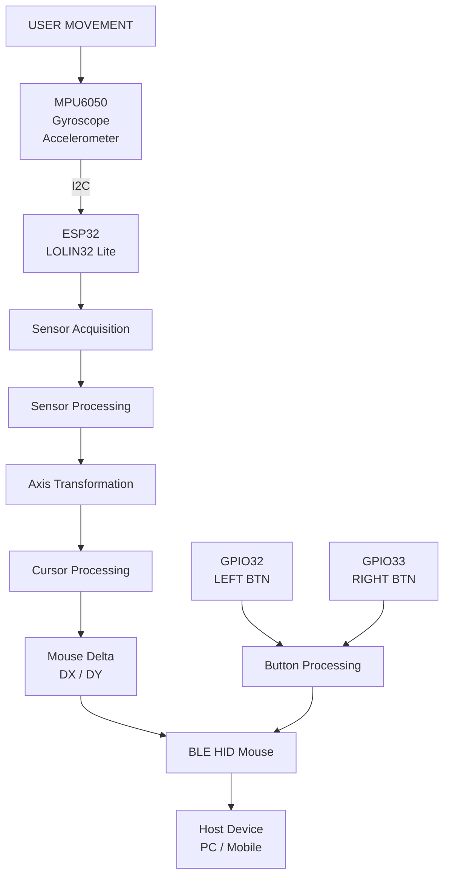

## 3.2 Firmware Processing Pipeline

Firmware memiliki dua jalur pemrosesan utama.

**Path A — Cursor Control**

Mengolah data gyro menjadi perpindahan kursor.

**Path B — Button Control**

Membaca kondisi dua tombol fisik, melakukan debouncing, dan menerjemahkan perubahan tombol menjadi HID mouse button reports.

Kedua jalur berjalan secara independen tetapi menggunakan BLE HID sebagai media output.

---

# 4. Firmware Functional Requirements

| ID     | Requirement                                    | Priority |
| ------ | ---------------------------------------------- | -------- |
| FR-001 | Firmware dapat menginisialisasi MPU6050        | High     |
| FR-002 | Firmware membaca gyro tiga sumbu               | High     |
| FR-003 | Firmware melakukan kalibrasi bias gyro         | High     |
| FR-004 | Firmware mendukung konfigurasi axis mapping    | High     |
| FR-005 | Firmware mengimplementasikan deadzone          | High     |
| FR-006 | Firmware mengimplementasikan low-pass filter   | High     |
| FR-007 | Firmware menghitung perpindahan kursor         | High     |
| FR-008 | Firmware dapat mengirim laporan BLE HID Mouse  | High     |
| FR-009 | Firmware mendeteksi koneksi BLE                | High     |
| FR-010 | Firmware membaca left button                   | High     |
| FR-011 | Firmware membaca right button                  | High     |
| FR-012 | Firmware mengimplementasikan button debouncing | High     |
| FR-013 | Firmware mengirim left click HID event         | High     |
| FR-014 | Firmware mengirim right click HID event        | High     |
| FR-015 | Firmware mendukung simultaneous button press   | Medium   |
| FR-016 | Firmware mendukung pengaturan sensitivitas     | Medium   |
| FR-017 | Firmware menyediakan Serial Debugging          | Medium   |
| FR-018 | Firmware dapat melakukan kalibrasi ulang       | Medium   |
| FR-019 | Firmware mendukung pause/resume                | Medium   |
| FR-020 | Firmware dapat menangani koneksi terputus      | High     |

---

# 5. Non-Functional Requirements

| ID      | Requirement                  | Target                                            |
| ------- | ---------------------------- | ------------------------------------------------- |
| NFR-001 | Sensor sampling rate         | 200 Hz                                            |
| NFR-002 | Processing interval          | 5 ms                                              |
| NFR-003 | Sensor-to-processing latency | Target ≤ 10 ms                                   |
| NFR-004 | Cursor movement              | Smooth and responsive                             |
| NFR-005 | BLE communication            | BLE HID                                           |
| NFR-006 | Runtime stability            | No blocking operation during normal operation     |
| NFR-007 | Sensor initialization        | Error detection required                          |
| NFR-008 | Calibration                  | Automatic during startup                          |
| NFR-009 | Memory management            | No unnecessary dynamic allocation in control loop |
| NFR-010 | Modularity                   | Independent processing modules                    |
| NFR-011 | Button response              | Responsive physical input                         |
| NFR-012 | Button debouncing            | 25 ms initial threshold                           |
| NFR-013 | Button state recovery        | No stuck HID button after disconnect              |

---

# 6. Core Firmware Logic

## 6.1 System Initialization

Saat perangkat dinyalakan, firmware melakukan urutan berikut:

1. Initialize Serial interface.
2. Initialize I2C.
3. Initialize MPU6050.
4. Configure accelerometer and gyroscope.
5. Configure sensor filter.
6. Initialize button GPIO.
7. Initialize button processing state.
8. Execute gyroscope calibration.
9. Initialize BLE HID service.
10. Initialize cursor processing.
11. Enter normal operating mode.

### Initialization State

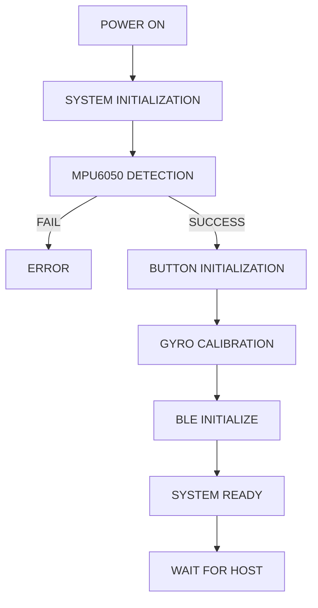

Jika MPU6050 tidak terdeteksi, firmware tidak boleh menjalankan cursor processing menggunakan data sensor yang tidak valid.

---

# 7. Sensor Acquisition Algorithm

## 7.1 Objective

Mengambil data gyroscope dari MPU6050 secara periodik.

Gyroscope menghasilkan kecepatan sudut pada tiga sumbu:

- X: Angular velocity X.
- Y: Angular velocity Y.
- Z: Angular velocity Z.

Data sensor dari library dapat berupa radian per detik sehingga perlu dikonversi menjadi derajat per detik.

## 7.2 Sampling Configuration

Sampling frequency:

\[
f_s = 200 \text{ Hz}
\]

Sampling interval:

\[
T_s = \frac{1}{f_s}
\]

\[
T_s = 0.005 \text{ s}
\]

Firmware menargetkan pembacaan sensor setiap 5 ms.

## 7.3 Unit Conversion

\[
\omega_{deg} = \omega_{rad} \times \frac{180}{\pi}
\]

Hasil pembacaan:

```text
gyroX = angular velocity X (deg/s)
gyroY = angular velocity Y (deg/s)
gyroZ = angular velocity Z (deg/s)
```

## 7.4 Sensor Acquisition Flow

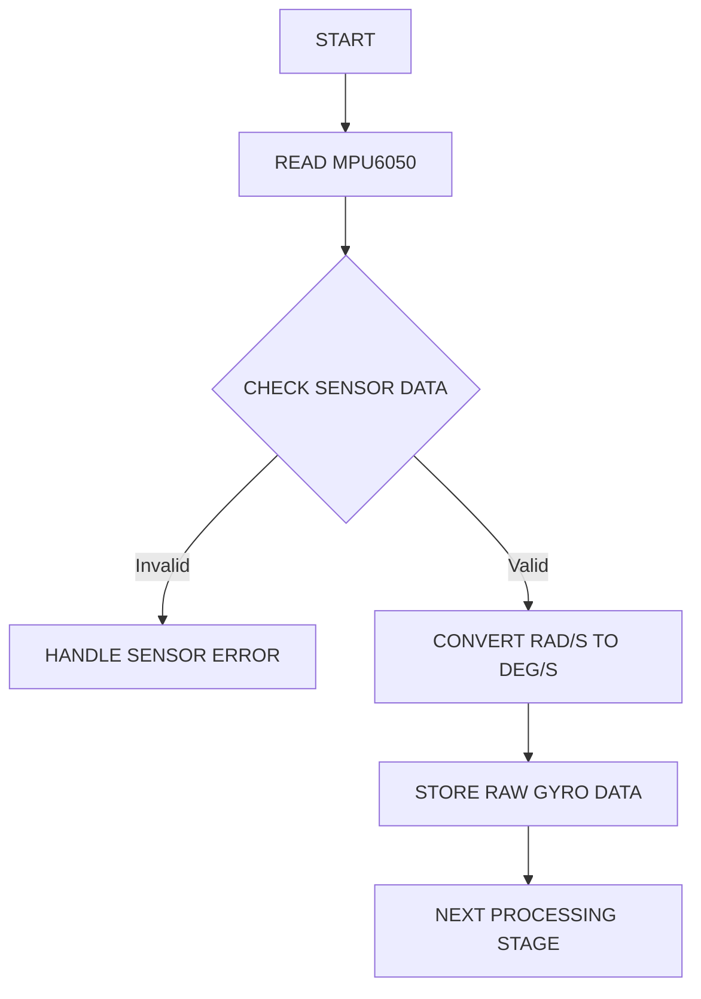

---

# 8. Gyroscope Calibration Algorithm

## 8.1 Objective

Gyroscope memiliki bias atau offset ketika perangkat dalam keadaan diam.

Bias menyebabkan pembacaan kecepatan sudut tidak selalu nol meskipun perangkat tidak bergerak.

Kalibrasi dilakukan untuk menghitung offset masing-masing sumbu.

## 8.2 Calibration Procedure

1. Perangkat harus berada dalam kondisi diam.
2. Ambil sejumlah sampel gyro.
3. Hitung nilai rata-rata masing-masing sumbu.
4. Simpan nilai rata-rata sebagai gyro bias.
5. Kurangi bias dari pembacaan berikutnya.

## 8.3 Calibration Formula

\[
B_x = \frac{1}{N}\sum_{i=1}^{N}G_{x,i}
\]

\[
B_y = \frac{1}{N}\sum_{i=1}^{N}G_{y,i}
\]

\[
B_z = \frac{1}{N}\sum_{i=1}^{N}G_{z,i}
\]

Keterangan:

- \(B\): Gyroscope bias.
- \(N\): Jumlah sampel.
- \(G\): Raw gyroscope measurement.

## 8.4 Bias Compensation

\[
G_{corrected}=G_{raw}-B
\]

## 8.5 Calibration Specification

| Parameter             | Initial Value                  |
| --------------------- | ------------------------------ |
| Calibration samples   | 500                            |
| Sampling interval     | 5 ms                           |
| Calibration duration  | 2.5 seconds                    |
| Calibration condition | Device stationary              |
| Calibration frequency | Startup / manual recalibration |

Firmware harus menyediakan validasi kestabilan selama kalibrasi. Jika perangkat bergerak secara signifikan, kalibrasi perlu dibatalkan atau diulang.

---

# 9. Axis Mapping Algorithm

## 9.1 Objective

Mengubah koordinat sensor menjadi koordinat logis perangkat.

Pemetaan ini diperlukan karena orientasi pemasangan MPU6050 dapat berbeda dari orientasi penggunaan remote.

## 9.2 Initial Mapping

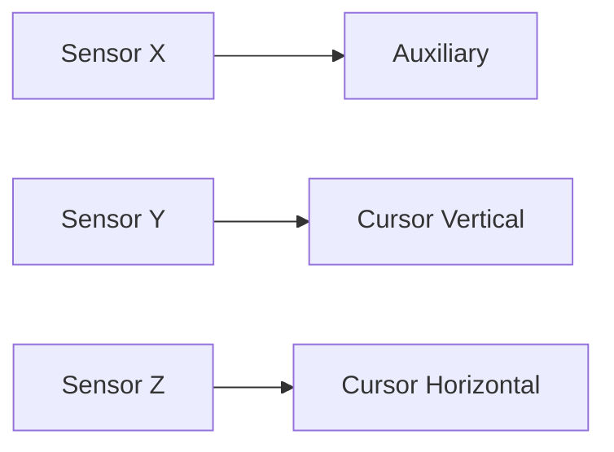

Setiap axis memiliki konfigurasi:

- Source axis.
- Direction sign.
- Enable/disable.

## 9.3 Transformation

\[
\omega_{horizontal}=s_z \times G_z
\]

\[
\omega_{vertical}=s_y \times G_y
\]

Dengan:

\[
s \in \{-1,+1\}
\]

Nilai sign dapat diubah untuk membalik arah gerakan.

Axis mapping harus ditempatkan dalam satu modul khusus agar perubahan orientasi sensor tidak mengharuskan perubahan seluruh algoritma.

---

# 10. Sensor Filtering Algorithm

## 10.1 Deadzone

Deadzone digunakan untuk mengabaikan pergerakan kecil yang disebabkan oleh noise dan sisa bias gyro.

\[
G_{dz} =
\begin{cases}
0 & |G| < D\\
G & |G| \geq D
\end{cases}
\]

Initial configuration:

```cpp
DEADZONE = 2.0f;
```

Nilai ini harus diuji karena terlalu besar akan menghilangkan gerakan tangan yang lambat.

## 10.2 Low-Pass Filter

Low-pass filter digunakan untuk mengurangi perubahan sinyal berfrekuensi tinggi.

Menggunakan Exponential Moving Average (EMA):

\[
F_t = \alpha X_t+(1-\alpha)F_{t-1}
\]

Keterangan:

- \(X_t\): Input gyro setelah deadzone.
- \(F_t\): Filtered gyro.
- \(\alpha\): Filter coefficient.

Initial configuration:

```cpp
FILTER_ALPHA = 0.25f;
```

Semakin kecil alpha, semakin halus hasil filter tetapi respons menjadi lebih lambat.

## 10.3 Filtering Flow

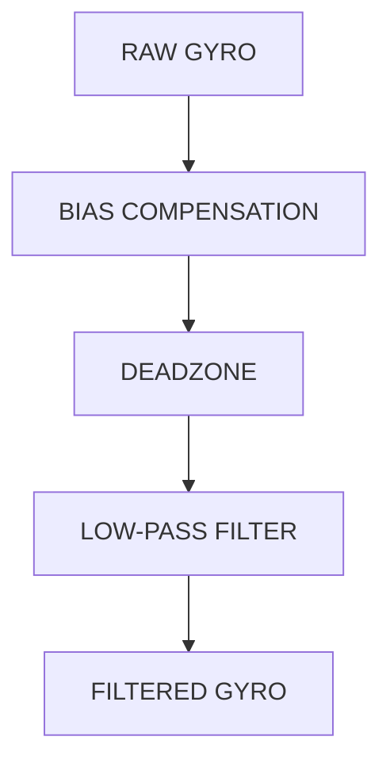

---

# 11. Cursor Movement Algorithm

## 11.1 Objective

Mengubah kecepatan rotasi remote menjadi perpindahan relatif kursor.

Sistem menggunakan angular velocity sebagai input utama.

Ketika pengguna memutar remote:

- Rotasi horizontal menggerakkan kursor ke kanan atau kiri.
- Rotasi vertikal menggerakkan kursor ke atas atau bawah.
- Ketika remote berhenti berputar, pergerakan kursor berhenti.

## 11.2 Angular Velocity Integration

Perpindahan sudut selama interval waktu:

\[
\Delta\theta = \omega \times \Delta t
\]

Perpindahan kursor:

\[
\Delta x=K_x \times \omega_z \times \Delta t
\]

\[
\Delta y=K_y \times \omega_y \times \Delta t
\]

Keterangan:

- \(\omega_z\): Horizontal angular velocity.
- \(\omega_y\): Vertical angular velocity.
- \(K_x\): Horizontal sensitivity.
- \(K_y\): Vertical sensitivity.
- \(\Delta t\): Actual processing interval.

## 11.3 Nonlinear Acceleration

Untuk menghasilkan kontrol yang lebih natural, sistem dapat menggunakan akselerasi berdasarkan kecepatan rotasi.

\[
G(\omega)=1+\beta|\omega|
\]

Kemudian:

\[
\Delta x=K_x \times \omega_z \times \Delta t \times G(\omega_z)
\]

\[
\Delta y=K_y \times \omega_y \times \Delta t \times G(\omega_y)
\]

Akselerasi harus dibatasi agar gerakan cepat tidak menghasilkan lonjakan kursor yang berlebihan.

## 11.4 Fractional Accumulator

BLE HID menggunakan nilai perpindahan kursor dalam satuan integer.

Perhitungan floating-point dapat menghasilkan nilai di bawah satu pixel.

Untuk mencegah hilangnya gerakan kecil, firmware menggunakan accumulator.

```text
accumulatorX += deltaX
accumulatorY += deltaY

outputX = INTEGER(accumulatorX)
outputY = INTEGER(accumulatorY)

accumulatorX -= outputX
accumulatorY -= outputY
```

## 11.5 Cursor Processing Flow

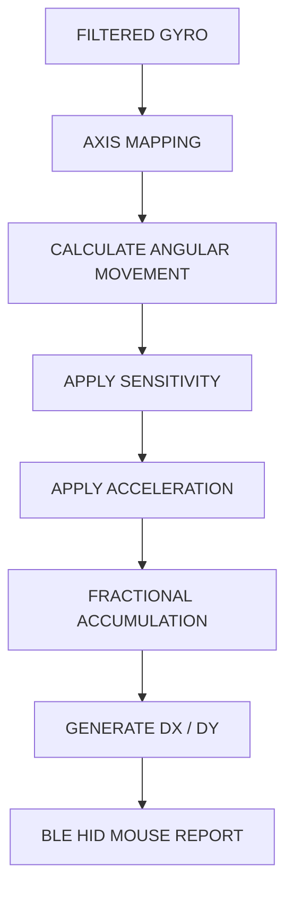

## 11.6 Initial Cursor Parameters

| Parameter                | Initial Value |
| ------------------------ | ------------: |
| Horizontal sensitivity   |           3.0 |
| Vertical sensitivity     |           3.0 |
| Deadzone                 |     2.0 deg/s |
| Acceleration coefficient |         0.015 |
| Filter alpha             |          0.25 |
| Maximum HID movement     |         ±127 |
| Processing interval      |          5 ms |

---

# 12. Physical Button Input Algorithm

## 12.1 Objective

Membaca dua tombol fisik yang berfungsi sebagai tombol kiri dan kanan mouse.

Tombol menggunakan mekanisme momentary push button dengan konfigurasi active-low.

Setiap tombol memiliki input processing yang independen.

## 12.2 Button Mapping

| Input        | GPIO   | HID Function |
| ------------ | ------ | ------------ |
| Left Button  | GPIO32 | Mouse Left   |
| Right Button | GPIO33 | Mouse Right  |

## 12.3 Input Logic

Karena menggunakan internal pull-up, kondisi tombol adalah:

| Physical Condition | GPIO Reading | Logical State |
| ------------------ | ------------ | ------------- |
| Tidak ditekan      | HIGH         | RELEASED      |
| Ditekan            | LOW          | PRESSED       |

Konversi:

```cpp
buttonPressed = (digitalRead(buttonPin) == LOW);
```

## 12.4 Button Debouncing

Mechanical push button dapat menghasilkan beberapa perubahan sinyal singkat ketika ditekan atau dilepas.

Fenomena ini disebut contact bounce.

Firmware menggunakan software debouncing agar satu penekanan tombol hanya menghasilkan satu perubahan state yang valid.

Algoritma:

1. Baca kondisi GPIO.
2. Bandingkan dengan raw state sebelumnya.
3. Jika berubah, simpan waktu perubahan.
4. Tunggu hingga kondisi stabil selama debounce interval.
5. Jika kondisi tetap sama, validasi sebagai perubahan state.
6. Kirim HID button report sesuai kondisi terbaru.

Debouncing dilakukan secara non-blocking menggunakan timestamp.

## 12.5 Debounce Formula

\[
T_{stable} \geq T_{debounce}
\]

Initial configuration:

```cpp
BUTTON_DEBOUNCE_MS = 25;
```

Kondisi tombol baru dianggap valid apabila tidak mengalami perubahan selama minimal 25 ms.

## 12.6 Button State Model

Setiap tombol mempunyai dua state logis:

- RELEASED
- PRESSED

Perubahan state menghasilkan event:

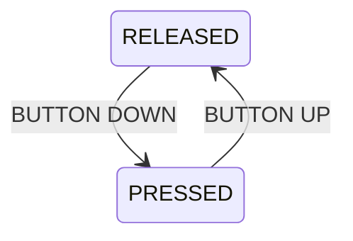

Tidak ada pengiriman event berulang selama tombol terus ditahan.

## 12.7 Button Processing Flow

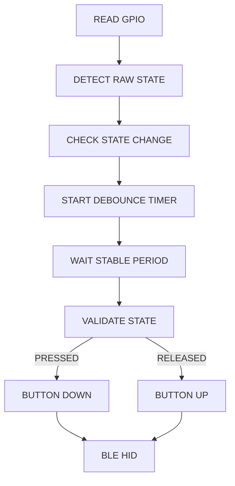

## 12.8 Left Click Processing

Ketika tombol GPIO32 ditekan:

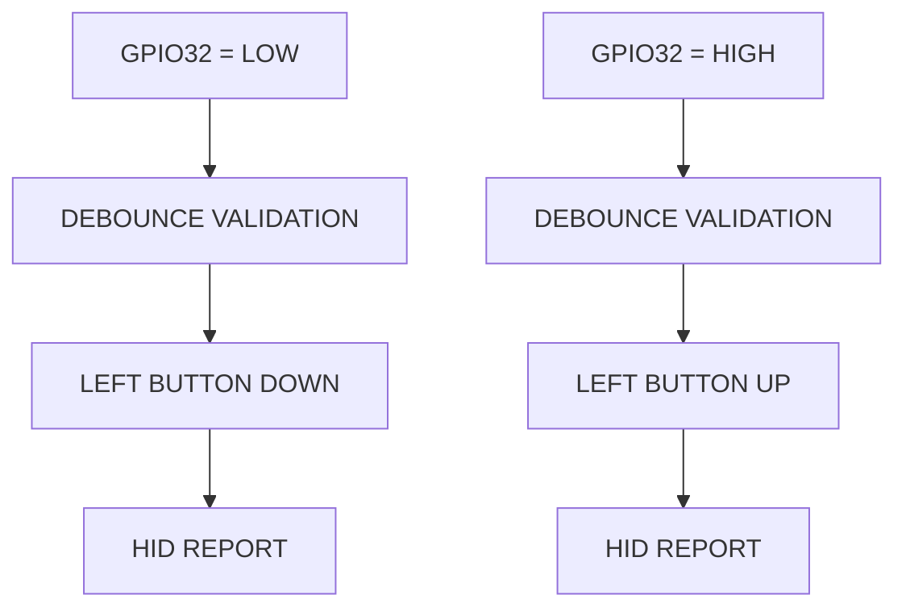

Ketika tombol dilepas:

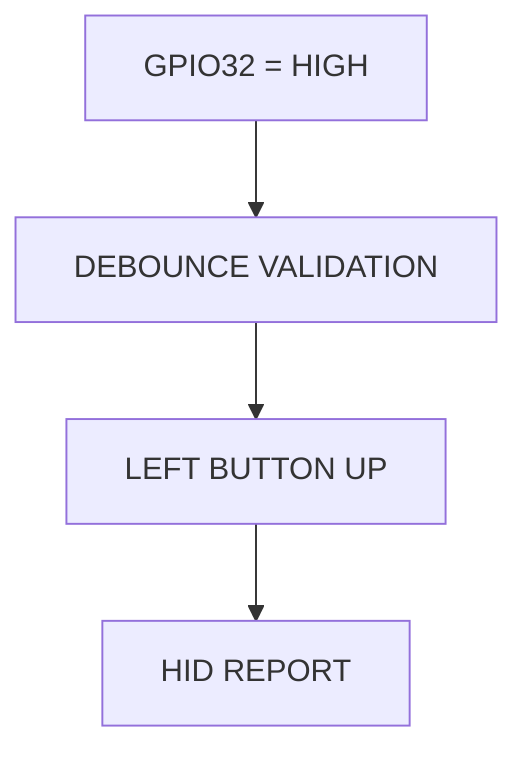

## 12.9 Right Click Processing

Ketika tombol GPIO33 ditekan:

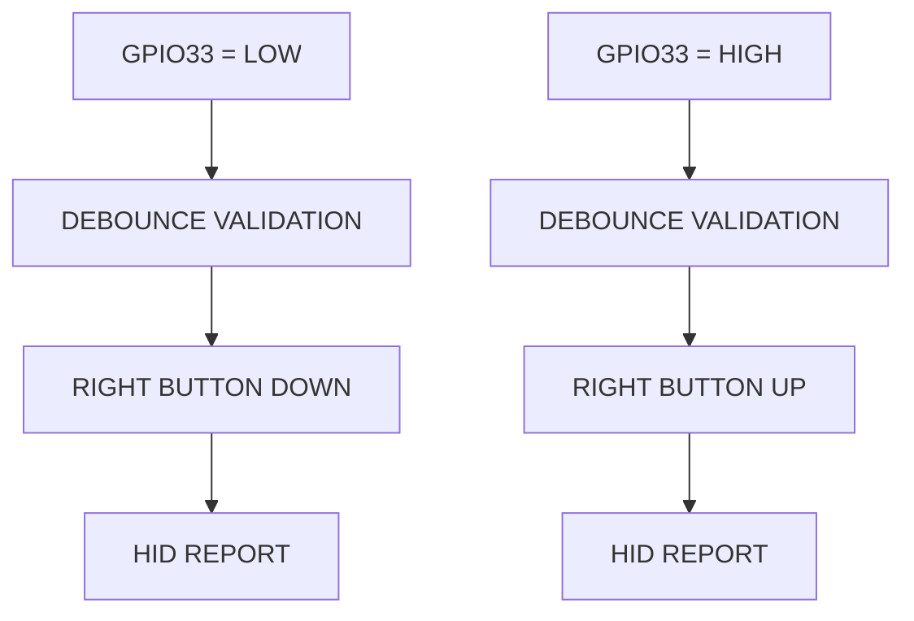

Ketika tombol dilepas:

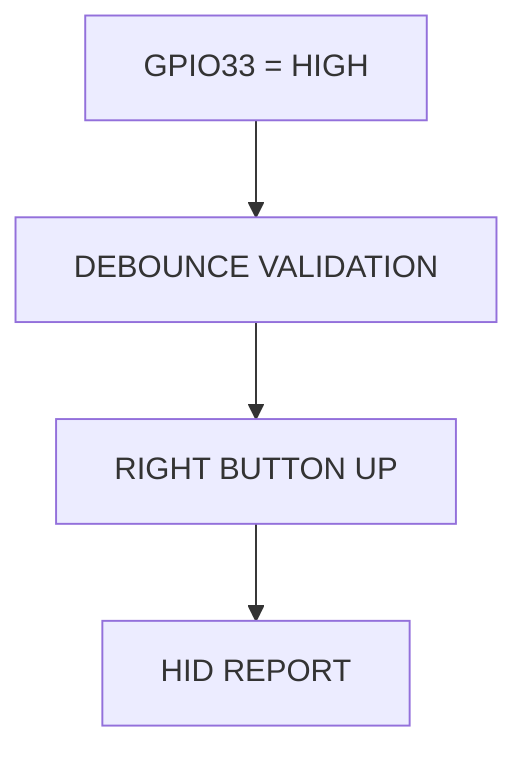

## 12.10 Simultaneous Button Press

Sistem harus mendukung kedua tombol ditekan secara bersamaan.

Contoh:

| Left Button | Right Button | HID State    |
| ----------- | ------------ | ------------ |
| Released    | Released     | No button    |
| Pressed     | Released     | Left         |
| Released    | Pressed      | Right        |
| Pressed     | Pressed      | Left + Right |

Firmware harus mengelola button state secara gabungan sehingga perubahan satu tombol tidak menghapus kondisi tombol lainnya.

## 12.11 Button Hold Behavior

Tombol menggunakan perilaku press-and-hold standar mouse.

| User Action          | HID Behavior       |
| -------------------- | ------------------ |
| Press left button    | Left button down   |
| Hold left button     | Left remains down  |
| Release left button  | Left button up     |
| Press right button   | Right button down  |
| Hold right button    | Right remains down |
| Release right button | Right button up    |

Perilaku ini memungkinkan fungsi drag-and-drop pada perangkat host.

---

# 13. BLE HID Communication

## 13.1 Communication Architecture

ESP32 beroperasi sebagai BLE peripheral dan HID mouse.

Host beroperasi sebagai BLE central.

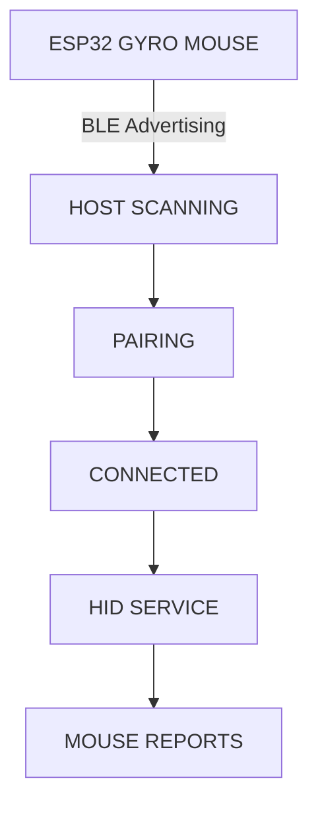

## 13.2 HID Functionality

| Function          | HID Operation  |
| ----------------- | -------------- |
| Cursor horizontal | Relative X     |
| Cursor vertical   | Relative Y     |
| Left click        | Button 1       |
| Right click       | Button 2       |
| Scroll            | Wheel (future) |

## 13.3 HID Button Report

HID mouse button state harus dapat merepresentasikan dua tombol secara bersamaan.

Konsep button bitmask:

| Bit   | Button |
| ----- | ------ |
| Bit 0 | Left   |
| Bit 1 | Right  |

Contoh:

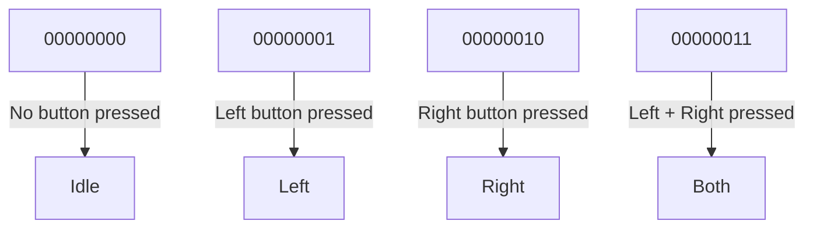

BLE HID report harus mempertahankan kondisi tombol yang sedang ditekan sampai tombol dilepas.

## 13.4 Connection State

BLE state:

- DISCONNECTED
- ADVERTISING
- CONNECTED

Perilaku:

**DISCONNECTED**

- Cursor report tidak dikirim.
- Button HID state direset.
- Tidak ada button state yang boleh tertahan.

**ADVERTISING**

- ESP32 mengiklankan layanan HID.
- Host dapat melakukan pairing atau koneksi.

**CONNECTED**

- Cursor movement aktif.
- Left click aktif.
- Right click aktif.
- HID report dikirim ketika terdapat perubahan input atau pergerakan kursor.

## 13.5 BLE Error Handling

Firmware harus menangani:

- Host disconnect.
- Reconnection.
- BLE stack initialization failure.
- HID report failure.
- Reset cursor accumulator setelah disconnect.
- Reset button state setelah disconnect.
- Pelepasan seluruh button state setelah disconnect.

Jika koneksi terputus ketika tombol masih ditekan, firmware harus menghapus state internal tombol. Jangan mengirim kondisi pressed lama setelah koneksi kembali.

---

# 14. Firmware Runtime State

## 14.1 System Operating State

| State        | Description                |
| ------------ | -------------------------- |
| INITIALIZING | Hardware initialization    |
| CALIBRATING  | Gyroscope calibration      |
| READY        | System initialized         |
| ADVERTISING  | BLE waiting for host       |
| CONNECTED    | Host connected             |
| PAUSED       | Cursor processing disabled |
| ERROR        | Critical error             |

## 14.2 Main State Flow

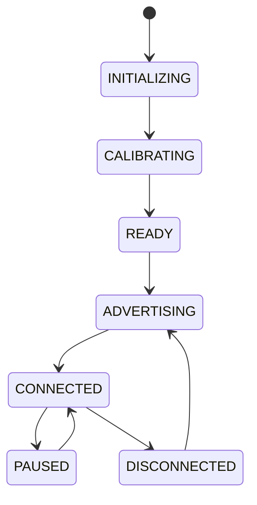

Button input dan sensor acquisition tetap dikelola secara terpisah dari state cursor pause.

Pada kondisi PAUSED, pergerakan kursor dinonaktifkan. Kebijakan button input tetap mengikuti konfigurasi sistem dan tidak boleh meninggalkan HID button state dalam kondisi pressed.

---

# 15. PlatformIO Development Specification

## 15.1 Development Environment

| Item             | Specification      |
| ---------------- | ------------------ |
| IDE              | Visual Studio Code |
| Extension        | PlatformIO IDE     |
| Platform         | Espressif 32       |
| Framework        | Arduino            |
| Board            | LOLIN32 Lite       |
| Language         | C++                |
| Build System     | PlatformIO         |
| Debug Interface  | Serial Monitor     |
| Upload Interface | USB Serial         |

## 15.2 Project Configuration

Contoh baseline `platformio.ini`:

```ini
[env:lolin32_lite]
platform = espressif32
board = lolin32_lite
framework = arduino

monitor_speed = 115200
upload_speed = 460800

lib_deps =
    adafruit/Adafruit MPU6050
    adafruit/Adafruit Unified Sensor
    h2zero/NimBLE-Arduino

build_flags =
    -DCORE_DEBUG_LEVEL=0

monitor_filters =
    time
    colorize
```

Catatan:

- Board ID harus diverifikasi terhadap versi platform Espressif32 yang digunakan. Jika `lolin32_lite` tidak tersedia, gunakan konfigurasi board ESP32 generik yang sesuai, misalnya `esp32dev`.
- BLE HID library perlu ditentukan dan diverifikasi pada tahap dependency integration.
- Jika menggunakan library HID berbasis NimBLE, pastikan versi NimBLE-Arduino sesuai dengan versi yang diwajibkan library tersebut.
- Jangan memasang dua implementasi BLE yang saling bertentangan.
- Versi PlatformIO platform dan dependency sebaiknya dikunci setelah build pertama berhasil.

## 15.3 Recommended Project Structure

```mermaid
flowchart TD
    A[gyro-mouse] --> B[platformio.ini]
    A --> C[include]
    A --> D[src]
    A --> E[test]
    C --> C1[Config.h]
    C --> C2[PinConfig.h]
    C --> C3[SensorConfig.h]
    C --> C4[FirmwareTypes.h]
    D --> D1[main.cpp]
    D --> D2[hardware]
    D --> D3[input]
    D --> D4[processing]
    D --> D5[connectivity]
    D --> D6[system]
    D --> D7[diagnostics]
    D2 --> D21[MPU6050Driver.cpp]
    D2 --> D22[MPU6050Driver.h]
    D3 --> D31[ButtonInput.cpp]
    D3 --> D32[ButtonInput.h]
    D4 --> D41[GyroCalibration.cpp]
    D4 --> D42[GyroCalibration.h]
    D4 --> D43[SensorFilter.cpp]
    D4 --> D44[SensorFilter.h]
    D4 --> D45[AxisMapping.cpp]
    D4 --> D46[AxisMapping.h]
    D4 --> D47[CursorProcessor.cpp]
    D4 --> D48[CursorProcessor.h]
    D5 --> D51[BleMouse.cpp]
    D5 --> D52[BleMouse.h]
    D6 --> D61[SystemState.cpp]
    D6 --> D62[SystemState.h]
    D6 --> D63[RuntimeConfig.cpp]
    D6 --> D64[RuntimeConfig.h]
    D7 --> D71[SerialDebug.cpp]
    D7 --> D72[SerialDebug.h]
    E --> E1[test_calibration]
    E --> E2[test_filter]
    E --> E3[test_axis_mapping]
    E --> E4[test_cursor]
    E --> E5[test_button]
```

## 15.4 Module Responsibilities

| Module          | Responsibility                        |
| --------------- | ------------------------------------- |
| MPU6050Driver   | Sensor initialization and acquisition |
| ButtonInput     | GPIO reading and debouncing           |
| GyroCalibration | Bias calculation                      |
| SensorFilter    | Deadzone and filtering                |
| AxisMapping     | Coordinate transformation             |
| CursorProcessor | Cursor delta calculation              |
| BleMouse        | BLE HID communication                 |
| SystemState     | System state management               |
| RuntimeConfig   | Configuration management              |
| SerialDebug     | Diagnostic output                     |

## 15.5 Software Design Principle

Gunakan prinsip separation of concerns.

Setiap modul harus memiliki tanggung jawab yang jelas.

Contohnya:

- Sensor driver tidak mengetahui tentang BLE.
- Button input tidak mengirim HID report secara langsung.
- Cursor processor tidak mengakses I²C secara langsung.
- BLE module tidak menghitung angular velocity.
- Main controller mengoordinasikan semua modul.

Dengan demikian, algoritma dapat diuji secara independen sebelum digabungkan dengan hardware.

---

# 16. Processing Scheduling

## 16.1 Main Processing Loop

Target sensor processing berjalan pada 200 Hz.

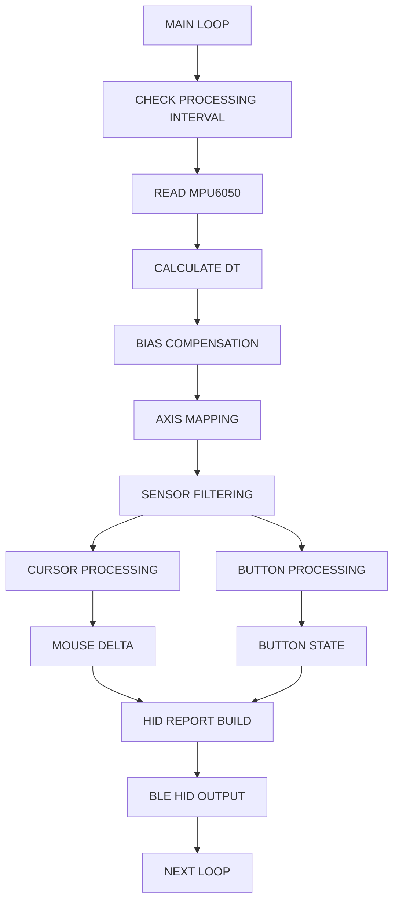

## 16.2 Scheduling Requirements

- Gunakan `micros()` untuk mengukur interval aktual.
- Gunakan timestamp untuk button debounce.
- Jangan mengandalkan `delay()` pada processing loop.
- Gunakan timestamp aktual untuk perhitungan delta time.
- Jangan melakukan Serial printing secara berlebihan.
- Batasi operasi BLE agar tidak menghambat sensor acquisition.
- Gunakan event-based communication untuk perubahan koneksi.
- Pastikan button polling tetap berjalan meskipun cursor processing sedang pause.

---

# 17. Configuration Specification

Seluruh parameter yang dapat dituning sebaiknya ditempatkan dalam konfigurasi terpusat.

Contoh `Config.h`:

```cpp
#pragma once

namespace GyroConfig {

    constexpr int SAMPLE_RATE_HZ = 200;

    constexpr float DEADZONE = 2.0f;

    constexpr float FILTER_ALPHA = 0.25f;

    constexpr float SENSITIVITY_X = 3.0f;

    constexpr float SENSITIVITY_Y = 3.0f;

    constexpr float ACCELERATION = 0.015f;

    constexpr int CALIBRATION_SAMPLES = 500;

}

namespace ButtonConfig {

    constexpr int LEFT_BUTTON_PIN = 32;

    constexpr int RIGHT_BUTTON_PIN = 33;

    constexpr uint32_t DEBOUNCE_MS = 25;

    constexpr bool ACTIVE_LOW = true;

}
```

Konfigurasi tersebut merupakan nilai awal untuk proses pengujian.

Parameter tidak boleh tersebar di banyak file sehingga menyulitkan proses tuning.

---

# 18. Error Handling & Recovery

| Condition                     | Expected Behavior             |
| ----------------------------- | ----------------------------- |
| MPU6050 not detected          | Enter ERROR state             |
| Invalid sensor data           | Discard invalid sample        |
| Sensor communication failure  | Retry or reinitialize         |
| BLE initialization failure    | Report error and retry safely |
| Host disconnect               | Reset cursor and button state |
| Button contact bounce         | Ignore unstable transition    |
| Button held during disconnect | Clear internal HID state      |
| Invalid calibration           | Repeat calibration            |
| Excessive sensor noise        | Ignore invalid movement       |
| HID report unavailable        | Retain no stale button state  |

Firmware tidak boleh mengirim perpindahan kursor menggunakan data sensor yang sudah tidak valid.

Jika terjadi disconnect, seluruh tombol HID harus berada dalam keadaan released.

---

# 19. Testing & Validation Plan

## 19.1 Unit Testing

| Test ID | Module       | Test Scenario                    | Expected Result           |
| ------- | ------------ | -------------------------------- | ------------------------- |
| UT-001  | Calibration  | Sensor diam                      | Bias terukur              |
| UT-002  | Calibration  | Sensor bergerak saat calibration | Calibration ditolak       |
| UT-003  | Filter       | Input di bawah deadzone          | Output zero               |
| UT-004  | Filter       | Input di atas deadzone           | Output terfilter          |
| UT-005  | Axis Mapping | Input gyro Z                     | Horizontal output         |
| UT-006  | Axis Mapping | Input gyro Y                     | Vertical output           |
| UT-007  | Cursor       | Positive angular velocity        | Correct cursor direction  |
| UT-008  | Cursor       | Negative angular velocity        | Opposite cursor direction |
| UT-009  | Button       | Left button pressed              | Left down                 |
| UT-010  | Button       | Left button released             | Left up                   |
| UT-011  | Button       | Right button pressed             | Right down                |
| UT-012  | Button       | Right button released            | Right up                  |
| UT-013  | Button       | Short contact bounce             | No duplicate event        |
| UT-014  | Button       | Both buttons pressed             | Both HID bits active      |
| UT-015  | Button       | Button held                      | No repeated click event   |
| UT-016  | Button       | Button released after hold       | HID button released       |

## 19.2 Integration Testing

| Test ID | Scenario               | Expected Result            |
| ------- | ---------------------- | -------------------------- |
| IT-001  | MPU6050 initialization | Sensor detected            |
| IT-002  | BLE advertising        | Device discoverable        |
| IT-003  | BLE pairing            | Host connected             |
| IT-004  | Cursor horizontal      | Pointer moves horizontally |
| IT-005  | Cursor vertical        | Pointer moves vertically   |
| IT-006  | Left button            | Left click works           |
| IT-007  | Right button           | Right click works          |
| IT-008  | Simultaneous buttons   | Both buttons recognized    |
| IT-009  | Button hold            | Drag operation works       |
| IT-010  | BLE disconnect         | Button state cleared       |
| IT-011  | BLE reconnect          | Mouse operation resumes    |

## 19.3 Compatibility Testing

| Host          | Test                                    |
| ------------- | --------------------------------------- |
| Windows 10/11 | Pairing and mouse movement              |
| Linux         | Pairing and mouse movement              |
| macOS         | Pairing and mouse movement              |
| Android       | Pointer availability and mouse movement |
| iOS/iPadOS    | AssistiveTouch and pointer behavior     |

## 19.4 Performance Testing

Pengujian harus mencakup:

- Sampling rate stability.
- Sensor-to-HID latency.
- Cursor smoothness.
- Button response latency.
- Button debounce reliability.
- False button triggering.
- BLE disconnection recovery.
- CPU utilization.
- Memory consumption.
- Battery operating duration.

---

# 20. Development Milestones

| Phase | Description                 | Deliverable                |
| ----- | --------------------------- | -------------------------- |
| P1    | PlatformIO project setup    | Compilable project         |
| P2    | MPU6050 integration         | Sensor acquisition         |
| P3    | Gyro calibration            | Bias compensation          |
| P4    | Filtering and axis mapping  | Stable sensor output       |
| P5    | Physical button integration | Validated GPIO input       |
| P6    | BLE HID integration         | Functional Bluetooth mouse |
| P7    | Cursor algorithm            | Air mouse control          |
| P8    | Button HID integration      | Left/right click           |
| P9    | System integration          | Complete firmware          |
| P10   | Performance testing         | Validated firmware         |
| P11   | Optimization                | Release candidate          |

Development sebaiknya dilakukan secara incremental. Setiap phase harus memiliki hasil pengujian sebelum melanjutkan ke phase berikutnya.

---

# 21. Initial Acceptance Criteria

Firmware versi pertama dapat dinyatakan memenuhi MVP apabila:

1. ESP32 LOLIN32 Lite berhasil melakukan initialization.
2. MPU6050 dapat dibaca secara konsisten.
3. Kalibrasi gyro menghasilkan bias yang dapat digunakan.
4. Gerakan rotasi horizontal menggerakkan kursor horizontal.
5. Gerakan rotasi vertikal menggerakkan kursor vertikal.
6. Kursor berhenti ketika perangkat berhenti berotasi.
7. Noise sensor tidak menyebabkan pergerakan kursor yang signifikan.
8. ESP32 dapat beroperasi sebagai BLE HID Mouse.
9. Host dapat melakukan pairing dan menerima mouse report.
10. Tombol pertama menghasilkan left click.
11. Tombol kedua menghasilkan right click.
12. Penekanan dan pelepasan tombol menghasilkan HID button state yang benar.
13. Kedua tombol dapat ditekan bersamaan.
14. Penahanan tombol mendukung drag operation.
15. Contact bounce tidak menghasilkan klik berulang.
16. BLE disconnect tidak meninggalkan button state dalam kondisi pressed.
17. Sistem dapat beroperasi secara stabil selama pengujian berkelanjutan.

---

# 22. Technical Considerations & Design Decisions

## 22.1 Gyroscope Drift

Gyroscope memiliki bias yang dapat berubah akibat temperatur dan kondisi sensor.

Kalibrasi startup hanya mengurangi bias awal. Untuk penggunaan jangka panjang, firmware perlu mempertimbangkan stationary bias estimation yang hanya aktif ketika perangkat benar-benar diam.

Jangan mengoreksi bias ketika pengguna sedang menggerakkan perangkat.

## 22.2 No Absolute Position

Sistem menggunakan relative mouse movement.

Tidak terdapat hubungan langsung antara posisi sudut remote dan posisi kursor pada layar.

Karena itu, perangkat tidak membutuhkan mekanisme reset posisi kursor.

## 22.3 Button Input Reliability

Dua tombol fisik menggunakan independent GPIO input.

Firmware harus memastikan:

- Setiap tombol memiliki debounce state sendiri.
- Penekanan tombol menghasilkan HID button down.
- Pelepasan tombol menghasilkan HID button up.
- Kedua tombol dapat aktif bersamaan.
- Tombol yang ditahan tidak menghasilkan event berulang.
- Koneksi terputus tidak meninggalkan tombol dalam kondisi pressed.

## 22.4 BLE HID Compatibility

BLE HID harus menggunakan HID service, report descriptor, dan mouse report yang sesuai dengan standar HID over GATT.

Implementasi BLE HID perlu diuji pada setiap target OS karena proses pairing, bonding, reconnect, dan pengaturan pointer dapat berbeda.

## 22.5 Future Enhancement

Fitur yang dapat ditambahkan setelah MVP:

- Scroll gesture.
- Middle click.
- Sensitivity profiles.
- Runtime calibration.
- Complementary filter.
- Adaptive deadzone.
- Dynamic acceleration.
- Battery monitoring.
- Persistent configuration.
- Pause/resume control.

---

# 23. Final System Definition

Gyro Mouse merupakan perangkat Bluetooth HID Mouse berbasis ESP32 LOLIN32 Lite dan MPU6050 yang menggunakan angular velocity sebagai input utama untuk menghasilkan relative cursor movement.

Sistem memiliki dua jalur pemrosesan utama:

**Cursor Control**

Sensor acquisition → Calibration → Axis mapping → Filtering → Cursor calculation → BLE HID report.

**Physical Button Control**

GPIO acquisition → Debouncing → Button state management → HID button mapping → BLE HID report.

Pengembangan firmware dilakukan menggunakan PlatformIO dengan Arduino Framework dan arsitektur modular berbasis C++.

### Final Hardware Mapping

| Component          | ESP32 LOLIN32 Lite |
| ------------------ | ------------------ |
| MPU6050 SDA        | GPIO21             |
| MPU6050 SCL        | GPIO22             |
| MPU6050 VCC        | 3V3                |
| MPU6050 GND        | GND                |
| Left Click Button  | GPIO32             |
| Right Click Button | GPIO33             |
| Button Ground      | GND                |

### Baseline Implementation Target

- ESP32 LOLIN32 Lite.
- MPU6050.
- Two physical push buttons.
- I²C 400 kHz.
- Gyroscope sampling 200 Hz.
- BLE HID Mouse.
- Air mouse berbasis angular velocity.
- Physical left click.
- Physical right click.
- Independent button debouncing.
- Simultaneous button support.
- PlatformIO + Arduino Framework.
- Modular firmware architecture.

**End of Document**
